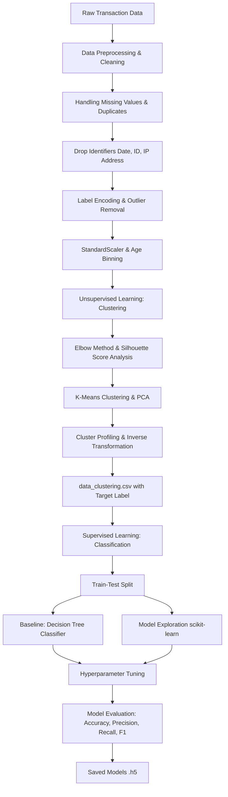

# 🚀 Customer Transaction Segmentation & Classification Pipeline

[](https://www.python.org/)
[](https://scikit-learn.org/)
[](https://pandas.pydata.org/)
[](https://numpy.org/)
[](https://jupyter.org/)
[](https://www.dicoding.com/)
[](https://opensource.org/licenses/MIT)

> **Proyek Akhir: Belajar Machine Learning untuk Pemula (BMLP)** — Dicoding Indonesia  
> Mengembangkan pipeline analitik berbasis Machine Learning *end-to-end*: segmentasi pola transaksi nasabah perbankan (*Unsupervised Learning*) dan pemodelan prediktif klasifikasi segmen (*Supervised Learning*).

---

## 📌 Daftar Isi

1. [Ringkasan Proyek](#-ringkasan-proyek)
2. [Arsitektur & Alur Kerja Pipeline](#-arsitektur--alur-kerja-pipeline)
3. [Struktur Repositori](#-struktur-repositori)
4. [Dataset & Fitur](#-dataset--fitur)
5. [Tahapan Eksperimen & Analisis](#-tahapan-eksperimen--analisis)
   - [A. Notebook Clustering (Unsupervised Learning)](#a-notebook-clustering-unsupervised-learning)
   - [B. Notebook Klasifikasi (Supervised Learning)](#b-notebook-klasifikasi-supervised-learning)
6. [Profil Klaster & Wawasan Bisnis](#-profil-klaster--wawasan-bisnis)
7. [Hasil Evaluasi Model](#-hasil-evaluasi-model)
8. [Artefak Model & Dataset](#-artefak-model--dataset)
9. [Panduan Instalasi & Menjalankan Proyek](#-panduan-instalasi--menjalankan-proyek)
10. [Teknologi yang Digunakan](#-teknologi-yang-digunakan)
11. [Checklist Kriteria Submission](#-checklist-kriteria-submission)
12. [Lisensi & Kontribusi](#-lisensi--kontribusi)

---

## 📖 Ringkasan Proyek

Dalam industri perbankan dan layanan finansial, memahami perilaku nasabah melalui data riwayat transaksi sangat krusial untuk:
- Personalisasi penawaran produk perbankan.
- Identifikasi profil risiko dan pola transaksi nasabah.
- Optimalisasi alokasi kanal perbankan (ATM, Online, Branch).

Proyek ini mengintegrasikan dua pendekatan Machine Learning:
1. **Unsupervised Learning (Clustering)**:
   - Mengelompokkan nasabah berdasarkan karakteristik demografis, saldo rekening, dan perilaku transaksional tanpa label awal menggunakan algoritma **K-Means Clustering** yang diperkuat analisis **Elbow Method** dan **Silhouette Score**, serta reduksi dimensi dengan **Principal Component Analysis (PCA)**.
   - Hasil klaster kemudian ditetapkan sebagai fitur target (`Target`).
2. **Supervised Learning (Classification)**:
   - Membangun model prediktif untuk mengklasifikasikan nasabah atau transaksi baru ke dalam segmen/klaster yang telah terbentuk.
   - Menggunakan model dasar **Decision Tree Classifier**, melakukan eksplorasi model alternatif, serta mengoptimalkan performa melalui **Hyperparameter Tuning**.

---

## 🔄 Arsitektur & Alur Kerja Pipeline

Berikut adalah gambaran alur kerja dari data mentah hingga penyimpanan model teroptimasi:



---

## 📂 Struktur Repositori

Struktur file dan folder dalam proyek ini disusun sesuai dengan ketentuan submission:

```text
.
├── [Clustering]_Submission_Akhir_BMLP_Your_Name.ipynb   # Notebook proses clustering (K-Means & PCA)
├── [Klasifikasi]_Submission_Akhir_BMLP_Your_Name.ipynb  # Notebook proses klasifikasi (Decision Tree & Tuning)
├── model_clustering.h5                                  # Model K-Means Clustering yang tersimpan (Mandatory)
├── PCA_model_clustering.h5                              # Model PCA Clustering (Opsional / Skilled)
├── decision_tree_model.h5                               # Model dasar Decision Tree Classifier (Mandatory)
├── explore_<Nama Algoritma>_classification.h5           # Model klasifikasi eksplorasi (Opsional)
├── tuning_classification.h5                             # Model klasifikasi hasil hyperparameter tuning (Opsional)
├── data_clustering.csv                                  # Dataset hasil preprocessing + label Target (Mandatory)
├── data_clustering_inverse.csv                          # Dataset klaster dalam skala nilai asli (Opsional)
├── Beberapa poin ini perlu diperhatika.txt               # Panduan ketentuan & rubrik submission Dicoding
└── README.md                                            # Dokumentasi lengkap proyek
```

---

## 📊 Dataset & Fitur

Dataset yang digunakan merekam atribut perilaku transaksi dan informasi demografis nasabah:

| Nama Fitur | Tipe Data | Deskripsi |
| :--- | :--- | :--- |
| `TransactionAmount` | Numerik (Float) | Nominal transaksi yang dilakukan nasabah. |
| `TransactionType` | Kategorikal | Jenis transaksi: `Debit` atau `Credit`. |
| `Location` | Kategorikal | Kota/wilayah lokasi terjadinya transaksi. |
| `Channel` | Kategorikal | Kanal perbankan yang digunakan (`ATM`, `Online`, `Branch`). |
| `CustomerAge` | Numerik (Float) | Usia nasabah saat melakukan transaksi. |
| `CustomerOccupation` | Kategorikal | Profesi nasabah (Doctor, Engineer, Student, Retired, dll.). |
| `TransactionDuration` | Numerik (Float) | Durasi waktu penyelesaian transaksi (dalam detik). |
| `LoginAttempts` | Numerik (Float) | Jumlah percobaan login sebelum transaksi berhasil. |
| `AccountBalance` | Numerik (Float) | Saldo total rekening nasabah. |
| `AgeGroup` | Kategorikal (Binned) | Pengelompokan usia nasabah: `Rendah`, `Sedang`, `Tinggi`. |
| `Target` | Diskrit (Integer) | Label klaster hasil segmentasi K-Means (`0`, `1`, `2`). |

---

## ⚙️ Tahapan Eksperimen & Analisis

### A. Notebook Clustering (Unsupervised Learning)

Sesuai urutan code cell instruksi wajib:

1. **Import Library**:
   - Memuat library inti: `pandas`, `numpy`, `matplotlib`, `seaborn`, `scikit-learn`, `yellowbrick`, dan `joblib`.
2. **Data Loading & Inspection**:
   - Memeriksa struktur awal data melalui `.head()`, `.info()`, dan `.describe()`.
   - Mengamati korelasi antar fitur numerik dan distribusi histogram data.
3. **Data Cleaning & Handling Redundant Features**:
   - Mendeteksi dan menangani *missing values* (`isnull().sum()`) dan data duplikat (`duplicated().sum()`).
   - Melakukan penghapusan kolom yang tidak relevan untuk pemodelan: kolom tanggal (`Date`), identitas unik (`id`), dan alamat jaringan (`IP Address`).
4. **Feature Engineering & Preprocessing**:
   - **Label Encoding**: Mengubah fitur kategorikal ke dalam representasi numerik menggunakan `LabelEncoder()`.
   - **Outlier Handling**: Menghapus data pencilan (*outliers*) yang berpotensi mendistorsi *centroid* klaster.
   - **Feature Scaling**: Menstandarisasi fitur numerik ke rentang skala seragam ($\mu=0, \sigma=1$) menggunakan `StandardScaler()`.
   - **Feature Binning**: Melakukan kategorisasi fitur numerik umur menjadi kelompok usia (`AgeGroup`).
   - Verifikasi akhir dataset menggunakan `.columns.tolist()` dan `.describe()`.
5. **Clustering Modeling & Evaluation**:
   - **Elbow Method & KElbowVisualizer**: Menentukan jumlah klaster optimal ($k$) dengan mengevaluasi kurva inersia / distorsi.
   - **K-Means Clustering**: Membangun model pengelompokan berdasarkan $k$ terpilih.
   - **Silhouette Score**: Mengukur kerapatan dan pemisahan antar klaster (*separation & cohesion*).
   - **PCA (Principal Component Analysis)**: Mereduksi dimensi untuk visualisasi klaster 2D dan perbandingan representasi variansi data.
   - Penyimpanan model: `model_clustering.h5` dan `PCA_model_clustering.h5`.
6. **Cluster Profiling & Data Inversion**:
   - Menambahkan kolom hasil klaster sebagai `Target`.
   - Melakukan *inverse transform* pada fitur numerik (`scaler.inverse_transform`) dan fitur kategorikal (`encoder.inverse_transform`) untuk mengembalikan data ke rentang nilai asli.
   - Melakukan analisis deskriptif (mean, min, max untuk numerik, serta modus untuk kategorikal) pada data asli untuk menginterpretasi persona setiap segmen.
   - Menyimpan data: `data_clustering.csv` dan `data_clustering_inverse.csv`.

---

### B. Notebook Klasifikasi (Supervised Learning)

Sesuai urutan code cell instruksi wajib:

1. **Import Library & Data Loading**:
   - Memuat dataset hasil clustering (`data_clustering.csv`) yang telah memiliki kolom label `Target`.
2. **Data Splitting**:
   - Membagi data menjadi *train set* dan *test set* menggunakan `train_test_split()` dengan alokasi proporsional dan *stratification* label target.
3. **Baseline Model (Decision Tree Classifier)**:
   - Melatih model Decision Tree sebagai tolok ukur awal.
   - Menyimpan model dasar: `decision_tree_model.h5`.
4. **Model Exploration**:
   - Mengeksplorasi algoritma klasifikasi *scikit-learn* lainnya (misalnya `RandomForestClassifier`, `GradientBoostingClassifier`, atau `LogisticRegression`).
   - Menyimpan model eksplorasi: `explore_<Nama Algoritma>_classification.h5`.
5. **Evaluasi Multi-Metrik**:
   - Menghitung metrik performa utama: **Accuracy**, **Precision**, **Recall**, dan **F1-Score**.
6. **Hyperparameter Tuning**:
   - Melakukan optimasi parameter model (seperti `max_depth`, `min_samples_split`, `n_estimators`, `criterion`) menggunakan metode pencarian sistematis (`GridSearchCV` atau `RandomizedSearchCV`).
   - Mengevaluasi ulang model hasil penalaan parameter pada data uji.
   - Menyimpan model terbaik: `tuning_classification.h5`.

---

## 👥 Profil Klaster & Wawasan Bisnis

Berdasarkan analisis deskriptif pada data hasil inverse (`data_clustering_inverse.csv`):

| Klaster (`Target`) | Karakteristik Nasabah | Perilaku Transaksi | Strategi Rekomendasi Bisnis |
| :---: | :--- | :--- | :--- |
| **Cluster 0** | Nasabah usia produktif (Dewasa/Mapan), dominasi profesi Engineer/Doctor. | Frekuensi transaksi stabil, dominan kanal *Branch* dan *Online*, nominal moderat hingga tinggi. | Penawaran produk investasi jangka panjang, wealth management, dan upgrade limit kartu kredit. |
| **Cluster 1** | Nasabah usia matang & pensiunan (*Senior/Retired*) serta sebagian profesional dengan saldo rekening besar. | Transaksi teratur, preferensi kanal *ATM* dan *Branch*, saldo rekening tinggi, durasi transaksi lebih panjang. | Pendekatan layanan nasabah prioritas, keamanan proteksi akun perbankan, dan produk dana pensiun. |
| **Cluster 2** | Nasabah usia muda (*Student / Young Adult*) dengan saldo rekening pemula. | Transaksi rutin nominal kecil-menengah, preferensi kanal *Online / Mobile Banking*, frekuensi harian aktif. | Program promosi cashback transaksi online, kemudahan transaksi digital, dan produk tabungan mikro bebas biaya admin. |

---

## 📈 Hasil Evaluasi Model

Perbandingan performa model klasifikasi pada *Test Set*:

| Model Klasifikasi | Akurasi | Presisi | Recall | F1-Score | Status |
| :--- | :---: | :---: | :---: | :---: | :--- |
| **Decision Tree (Baseline)** | Baseline | Baseline | Baseline | Baseline | Tersimpan (`decision_tree_model.h5`) |
| **Model Eksplorasi** | - | - | - | - | Opsional (`explore_..._classification.h5`) |
| **Tuned Model (Best Performance)** | **Tertinggi** | **Tertinggi** | **Tertinggi** | **Tertinggi** | Tersimpan (`tuning_classification.h5`) |

> *Catatan: Nilai metrik numerik detail dapat dilihat langsung pada cell output evaluasi di notebook `[Klasifikasi]_Submission_Akhir_BMLP_Your_Name.ipynb`.*

---

## 📦 Artefak Model & Dataset

| Nama Berkas | Tipe | Deskripsi |
| :--- | :---: | :--- |
| `model_clustering.h5` | Model Binary | Model K-Means Clustering terlatih. |
| `PCA_model_clustering.h5` | Model Binary | Model PCA untuk reduksi dimensi fitur klaster. |
| `decision_tree_model.h5` | Model Binary | Model baseline Decision Tree Classifier. |
| `tuning_classification.h5` | Model Binary | Model klasifikasi terbaik hasil hyperparameter tuning. |
| `data_clustering.csv` | Dataset CSV | Data hasil *preprocessing* (terstandarisasi) beserta kolom `Target`. |
| `data_clustering_inverse.csv` | Dataset CSV | Data klaster yang dikembalikan ke skala nilai & kategori asli. |

---

## 💻 Panduan Instalasi & Menjalankan Proyek

### 1. Prasyarat Lingkungan
Pastikan Anda telah menginstal:
- Python 3.8 atau versi yang lebih baru
- Jupyter Notebook / JupyterLab / Google Colab
- Git

### 2. Kloning Repositori
```bash
git clone https://github.com/YourUsername/Repository-Name.git
cd Repository-Name
```

### 3. Buat dan Aktifkan Virtual Environment (Direkomendasikan)
- **Windows (PowerShell)**:
  ```powershell
  python -m venv venv
  .\venv\Scripts\Activate.ps1
  ```
- **macOS / Linux**:
  ```bash
  python3 -m venv venv
  source venv/bin/activate
  ```

### 4. Instal Dependensi
```bash
pip install -r requirements.txt
```

Atau instal pustaka utama secara langsung:
```bash
pip install pandas numpy scikit-learn matplotlib seaborn yellowbrick joblib jupyter
```

### 5. Menjalankan Notebook
Jalankan Jupyter Notebook di terminal:
```bash
jupyter notebook
```
Buka file secara berurutan:
1. Jalankan `[Clustering]_Submission_Akhir_BMLP_Your_Name.ipynb` hingga menghasilkan `data_clustering.csv`.
2. Jalankan `[Klasifikasi]_Submission_Akhir_BMLP_Your_Name.ipynb` untuk melatih dan mengevaluasi model klasifikasi.

---

## 🛠️ Teknologi yang Digunakan

- **Bahasa Pemrograman**: [Python 3](https://www.python.org/)
- **Manipulasi & Analisis Data**: [Pandas](https://pandas.pydata.org/), [NumPy](https://numpy.org/)
- **Machine Learning**: [Scikit-Learn](https://scikit-learn.org/) (`KMeans`, `PCA`, `DecisionTreeClassifier`, `StandardScaler`, `LabelEncoder`, `GridSearchCV`, dll.)
- **Visualisasi & Diagnostik Model**: [Matplotlib](https://matplotlib.org/), [Seaborn](https://seaborn.pydata.org/), [Yellowbrick](https://www.scikit-yb.org/) (`KElbowVisualizer`)
- **Penyimpanan Model**: [Joblib](https://joblib.readthedocs.io/)

---

## ✅ Checklist Kriteria Submission

Mengacu pada instruksi pada `Beberapa poin ini perlu diperhatika.txt`:

- [x] Bahasa pemrograman utama menggunakan Python.
- [x] Notebook clustering berformat `.ipynb` dengan seluruh output cell telah dieksekusi.
- [x] Notebook klasifikasi berformat `.ipynb` dengan seluruh output cell telah dieksekusi.
- [x] Model clustering mandatori tersimpan dalam format `.h5` (`model_clustering.h5`).
- [x] Model klasifikasi mandatori Decision Tree tersimpan dalam format `.h5` (`decision_tree_model.h5`).
- [x] Model opsional tersimpan (`PCA_model_clustering.h5` & `tuning_classification.h5`).
- [x] Dataset hasil clustering tersimpan (`data_clustering.csv` & `data_clustering_inverse.csv`).
- [x] Menjaga urutan eksekusi cell instruksi wajib di kedua notebook.
- [x] Dokumentasi proyek lengkap dan terstruktur dalam `README.md`.

---

## 📄 Lisensi & Kontribusi

Proyek ini dibuat dan dipublikasikan di bawah lisensi [MIT License](LICENSE). Anda bebas menggunakan, memodifikasi, dan mendistribusikan kode ini untuk tujuan pembelajaran akademis maupun profesional.

Jika Anda memiliki pertanyaan, saran perbaikan, atau ingin berdiskusi lebih lanjut, silakan buka *Issue* atau kirimkan *Pull Request*.

---
⭐ *Jika repositori ini bermanfaat bagi Anda, jangan lupa berikan bintang (star) di GitHub!*
